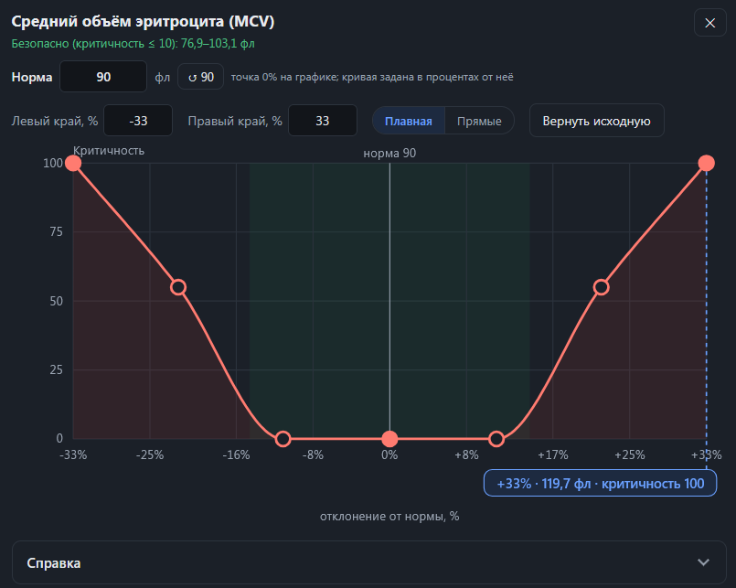

# Электродоктор

Сайт: [andre4561.github.io/electrodoctor](https://andre4561.github.io/electrodoctor/)

Открытый вычислитель дифференциальной диагностики: анализы, жалобы и данные осмотра на входе, 3–4 вероятных диагноза с процентами на выходе.

Каждый шаг расчёта — явная формула, и для каждого диагноза видно, какой показатель сколько добавил к вероятности. Искусственный интеллект используется для заполнения данных и трактовки рассчитанных выводов, но не внутри самого расчёта.

> ⚠️ Исследовательский проект. Не медицинское изделие, не для самодиагностики и не для лечебных решений. Все коэффициенты в репозитории пока условные. См. [DISCLAIMER.md](DISCLAIMER.md).

Контекст для ИИ-агентов — [AGENTS.md](AGENTS.md).

## Как это работает (кабинет)

1. Данные клиента вносятся в анкету (вручную, через ИИ, чат «Поговорить с доктором» на
   вкладках Общее и Параметры, или импорт; можно и экспортировать): общее, параметры,
   анализы, психолог.
2. Для показателей считаются отклонение от нормы и сила (по критичности или по проценту

   отклонения — переключатель в настройках). Норма здесь — не «среднее по лаборатории»,
    а ориентир **эгоморфа**: форма человека, к которой он рассчитан (генотип, подходящая
    среда); отклонение от неё — движение к ксеноморфу. Подробнее — в [drafts/идеология.md](drafts/идеология.md).

    

    Врач или исследователь может задать для каждого анализа своё значение нормы и поправить кривую критичности — глобально в настройках (для всех клиентов) или отдельно у конкретного пациента; личная настройка перекрывает общую.
3. По признакам диагнозов (`docs/data/signs.json`) складываются вклады «за» и «против».
4. Вероятность: `балл = logit(исходная частота) + сумма вкладов`, `P = 1 / (1 + e^−балл)`.
5. На вкладке «Диагнозы» видны проценты, разбивка вкладов и что досдать; оттуда же можно
   перейти к признакам диагноза в настройках (сразу к нужному диагнозу) и запросить
   консультацию искусственного интеллекта.

Данные расчёта в `docs/data/`:

- `labs.json` — каталог анализов (коды, синонимы, группа по материалу; правки и новые коды — в кабинете: Настройки → Анализы)
- `norms.json` — нормы и кривые критичности
- `signs.json` — признаки диагнозов и веса
- `diagnoses.json` — разделы специальностей и список диагнозов

Формат данных: [docs/data-format.md](docs/data-format.md). Дорожная карта: [docs/roadmap.md](docs/roadmap.md).

## Быстрый старт — посмотреть сайт

Нужен Python 3. Сайт лежит в `docs/` — файлы с диска открывать не надо.

Самый простой способ: дважды щёлкните `открыть-сайт.bat` в корне проекта. Он поставит пакет `markdown` при необходимости, запустит сервер и откроет браузер.

Или вручную:

```bash
pip install markdown
python tools/preview.py   # → http://localhost:8000/
```

Кабинет: http://localhost:8000/app/#/clients

Подробнее, как открыть сайт — [Читать.md](Читать.md).

## Структура

```
electrodoctor/
├── README.md              этот файл
├── AGENTS.md              контекст проекта для ИИ-агентов
├── .github/workflows/     проверка CI и публикация сайта на FTP
├── DISCLAIMER.md          ограничения и предупреждения
├── CONTRIBUTING.md        как предлагать веса, диагнозы, код
├── Читать.md              как открыть сайт локально
├── открыть-сайт.bat       запуск локального сервера
├── карта-сайта.drawio     схема страниц сайта
├── LICENSE                GNU AGPL v3 (код)
├── LICENSE-DATA           CC BY-SA 4.0 (данные и документация)
├── LICENSE.md             что под какой лицензией
├── src/app/               кабинет (TypeScript)
├── docs/                  сайт (GitHub Pages); *.js собираются из src/
│   ├── index.html         главная
│   ├── app/               кабинет в браузере
│   ├── data/              данные расчёта (JSON)
│   ├── data-format.md     форматы данных
│   ├── roadmap.md         что дальше
│   └── articles/          статьи (Markdown)
├── tests/                 тесты
└── tools/                 просмотр сайта и конвейер данных
```

## Публикация на хостинг (FTP)

Готовый сайт дополнительно выкладывается на хостинг по обычному FTP без шифрования: сервер `32rumba.ru` (адрес `45.67.58.17`), порт 21. Логин и пароль при этом идут открытым текстом. GitHub Pages не меняется и по-прежнему собирает папку `docs/` с ветки `main`.

Workflow — [`.github/workflows/deploy-ftp.yml`](.github/workflows/deploy-ftp.yml). Он собирает кабинет (`npm ci` и `npm run build`: JavaScript из `src/` попадает в `docs/`) и прогоняет Markdown через Jekyll тем же сборщиком, что и GitHub Pages. Сборщик в режиме production сам подставляет базовый путь `/electrodoctor`; для корня хостинга workflow на время сборки задаёт пустой `baseurl`, чтобы стили и шапка статей открывались с `https://32rumba.ru/`. На хостинг уходит уже готовая папка `_site/` — в каталог, в который FTP-пользователь попадает сразу после входа. Отдельный путь на сервере не задаётся.

Секреты добавляются в репозитории: **Settings → Secrets and variables → Actions → New repository secret**.

- `FTP_USERNAME` — логин FTP
- `FTP_PASSWORD` — пароль FTP

По расписанию выкладка идёт в 00:00 UTC (03:00 по Москве) в такие дни месяца: 1, 4, 7, 10, 13, 16, 19, 22, 25, 28 и 31. Вручную: вкладка **Actions** → **Публикация на FTP** → **Run workflow**.

## Лицензия

Код — [GNU AGPL v3](LICENSE), данные и документация — [CC BY-SA 4.0](LICENSE-DATA). Подробнее в [LICENSE.md](LICENSE.md).
